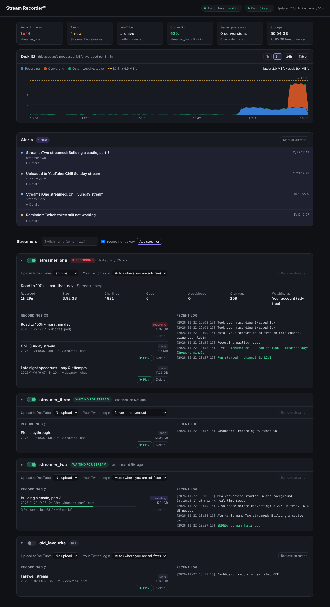
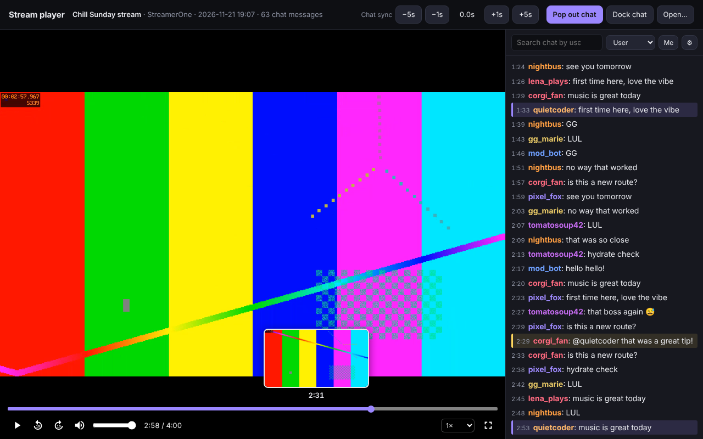
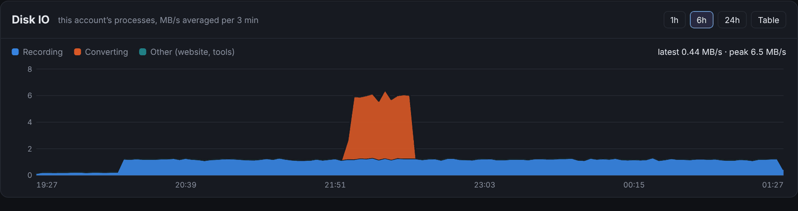
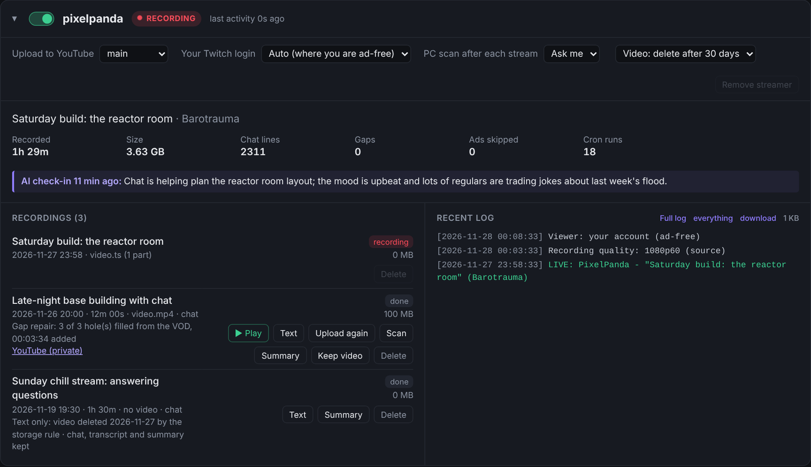

<p align="center">
  
</p>

<h1 align="center">Stream Recorder™</h1>

<p align="center">
  <a href="https://github.com/LandonGam3r/stream-recorder/releases/latest"></a>
  <a href="https://github.com/LandonGam3r/stream-recorder/actions/workflows/check.yml"></a>
  <a href="LICENSE"></a>
  
</p>

<p align="center"><b>Automatically record Twitch streams — video and chat — on a cheap shared web host or your own computer, and manage everything from one web dashboard.</b></p>

Plain PHP, no database, no framework, no build step. Upload two folders and add one cron line, or run one script locally.



## Features

- **Hands-off recording.** Add a streamer, switch recording on, and every stream is recorded from the moment it starts. No video is lost between runs, even on hosts that only allow short-lived processes.
- **Chat included.** Chat is logged next to the video and replays in sync, also across ad breaks and stream hiccups.
- **Lossless MP4.** Finished streams are converted to MP4 without re-encoding, in the background, at a speed your host can handle.
- **Web dashboard.** Switch streamers on and off, see live status, alerts, disk IO and server processes, and play or delete recordings.
- **Player with pop-out chat.** Watch a recording with chat docked or in a separate window (second screen). Search the chat by username or text and jump to any message. Preview pictures appear when you hover the seek bar, and your own messages and mentions are highlighted. It downloads to your PC first for smooth playback, or streams.
- **Optional YouTube upload.** Upload finished streams per streamer, resumable for files of any size. *Moments* rules scan chat and stream info (raids, hype bursts, a user's message, a category) and tag the title and description with timestamps. Any recording can also be uploaded by hand.
- **Subtitles and translation (optional).** A PC scan recognises what the streamer says, in the browser on your own graphics card. It makes subtitles, translated subtitles and translated chat for the player, and spoken-word moments for YouTube. Also works stand-alone for footage on your PC ([details](docs/pc-scan.md)).
- **AI summary of each stream (optional).** A written overview with a timeline and highlights, from what the streamer said, the chat and pictures from the video, so you can catch up on a missed stream. Written by Claude (well under 1 cent per stream) or, free, by Chrome's built-in AI on your PC ([details](docs/ai-summary.md)).
- **Optional ad-free recording.** Uses your own Twitch login where your account is ad-free (subscriptions/Turbo).
- **Built for shared hosting.** Works within short process lifetimes, disk IO limits, memory limits and blocked ports; [details](docs/how-it-works.md).
- **Secure by default.**
  - Login with a long random key, HTTPS forced, and brute-force protection that also works behind Cloudflare.
  - Tokens are encrypted with a passphrase that is never stored next to them.
  - See [docs/security.md](docs/security.md).

| Player with chat | IO graph | Streamer card |
|---|---|---|
|  |  |  |

## Quick start

### On your own computer (Linux, macOS, or Windows with WSL)

```bash
git clone https://github.com/LandonGam3r/stream-recorder.git
cd stream-recorder
./start-local.sh
```

Open the address it prints, log in with the key it shows, and add a streamer. Needs PHP 8.0+ (with curl) and, for MP4 conversion, ffmpeg. → [docs/install-local.md](docs/install-local.md)

### On a web server (shared hosting with cPanel, or any Linux server)

1. Upload the files in `server/` to a folder **outside** your public web root, e.g. `/home/you/twitch-recorder/`.
2. Upload `dashboard/` into your web root under a hard-to-guess name, e.g. `public_html/rec-7f3k9q/`.
3. Add one cron job, every minute:
   ```
   * * * * * REC_KEY=YourLongPassphrase123 /usr/bin/php -q /home/you/twitch-recorder/record.php >> /home/you/twitch-recorder/cron_output.txt 2>&1
   ```
4. Open `https://your-site/rec-7f3k9q/` and log in with the key from `twitch-recorder/secret/dashboard_key.txt`.

→ Full guide with every detail: [docs/install-webserver.md](docs/install-webserver.md)

## Documentation

| | |
|---|---|
| [Install on a web server](docs/install-webserver.md) | cPanel/shared hosting step by step, ffmpeg, cron |
| [Install locally](docs/install-local.md) | The start script, running it permanently, options |
| [Configuration](docs/configuration.md) | Every setting of the recorder and the dashboard |
| [Using the dashboard](docs/dashboard.md) | Streamers, alerts, IO graph, playing and deleting |
| [Twitch token](docs/twitch-token.md) | Optional ad-free recording with your own login |
| [YouTube upload](docs/youtube.md) | Google project setup, accounts, limits |
| [AI summary](docs/ai-summary.md) | Claude or Chrome's built-in AI, setup, cost, privacy |
| [How it works](docs/how-it-works.md) | Architecture, relay recording, conversion, files |
| [Security](docs/security.md) | What's protected how, and what to keep private |
| [Troubleshooting](docs/troubleshooting.md) | Log messages and common problems |
| [PC tools](pc-tools/README.md) | Stand-alone player and YouTube folder uploader |
| [Changelog](CHANGELOG.md) | What changed in each version |

## Requirements

- **PHP 8.0 or newer** with the `curl` and `openssl` extensions, and `exec()` allowed (it is on most hosts).
- **Linux or macOS** (Windows via WSL). The IO graph needs Linux's `/proc`.
- **ffmpeg** for MP4 conversion (optional; without it you keep `.ts` files, which VLC plays). On shared hosting you can upload a static build.
- **A browser** for the dashboard. Downloading recordings to your PC from the player needs Chrome or Edge; other browsers get plain download links.

## Disclaimer

This is an independent hobby project, not affiliated with or endorsed by Twitch, Amazon, Google or YouTube. It reads streams the way Twitch's own web player does, through Twitch's internal (undocumented) web API, like other open-source stream recorders. That can change or break at any time, and automated access may not be allowed by the letter of Twitch's Terms of Service. Use it for personal archiving. Only re-upload or share someone else's stream with their permission.

## License

[MIT](LICENSE) © 2026 LandonGam3r
