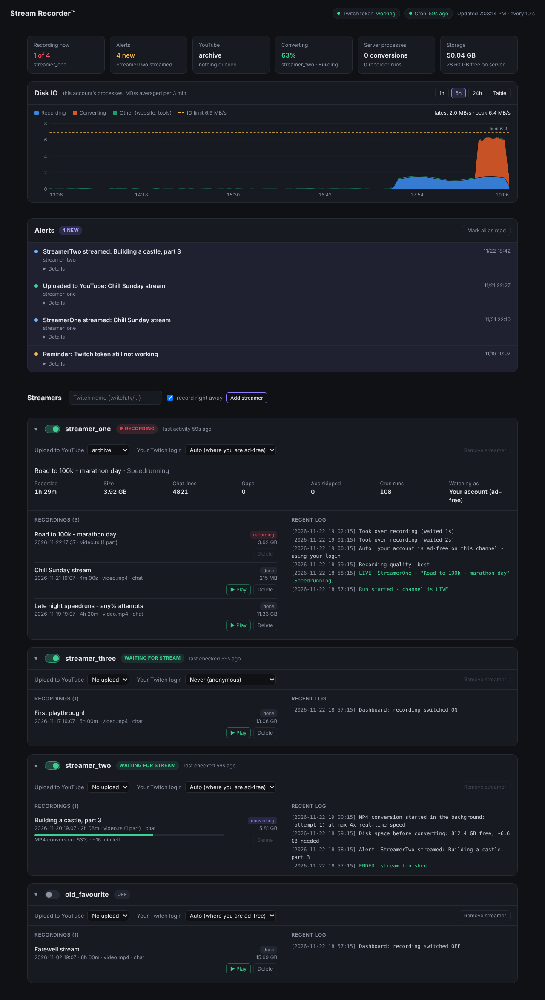
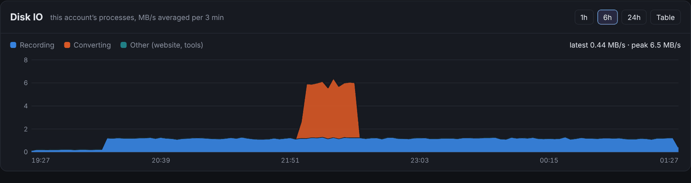
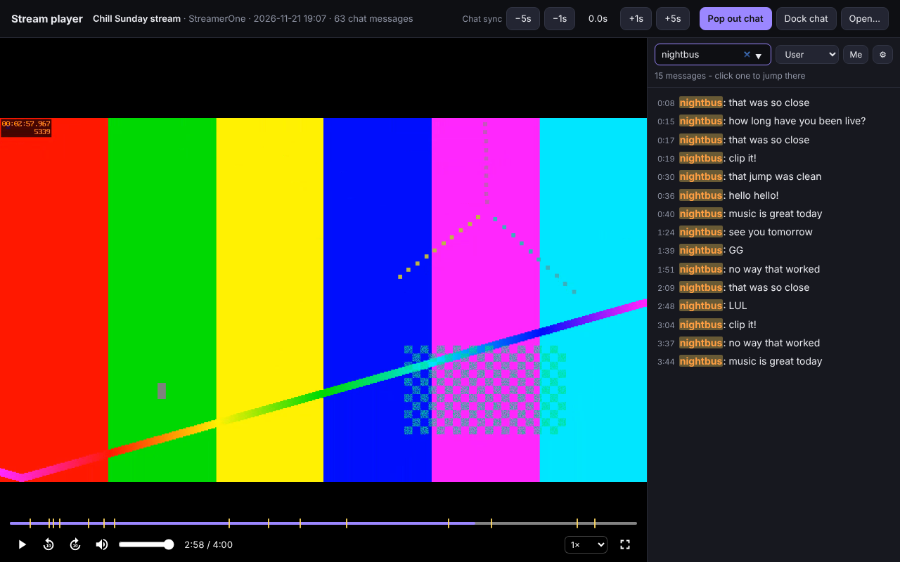
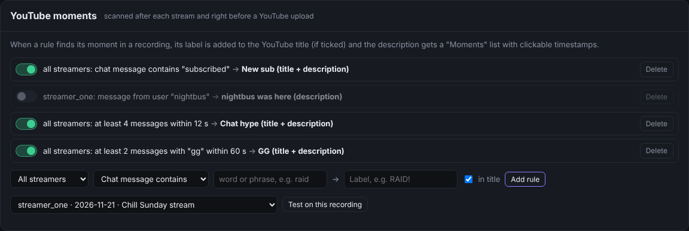

# Using the dashboard

## Logging in

Open the dashboard's address and paste the key from `secret/dashboard_key.txt` (in the recorder folder; the local start script also prints it). The browser stays logged in for 180 days, and a password manager can save the key.

- **New key / log out every browser:** delete both `dashboard_key.txt` and `dashboard_key.hash`. The next recorder run creates a new key.
- After logging in on all your devices you may delete `dashboard_key.txt`; the dashboard only needs the `.hash`.

## Header

- **Twitch token**: working, not working, or not set (hover for details). Only relevant if you use the [token](twitch-token.md).
- **Cron**: when the recorder last ran. It turns red when there has been no run for 3 minutes (the cron job or start script stopped).

## Tiles

One row that adapts to what's going on:
- **Recording now**: how many streamers are live.
- **Alerts**: new alerts, shown when there are any.
- **YouTube**: accounts and queue.
- **Converting / Uploading**: shown while those run.
- **Server processes**: running conversions and recorder runs. Red if two conversions ever run at once.
- **Storage**: space used, and free space.

## Disk IO

- **What it shows:** how much the account's processes read and write per second, split into recording, converting and other (your website, other tools), over 1 h, 6 h or 24 h.
- **The dashed line** is your host's limit (`IO_LIMIT_MB` in the dashboard config).
- **Details:** hover for exact numbers, or switch to *Table*.
- **Accuracy:** measured every 5 seconds from Linux's per-process disk counters. Very short processes (single web requests) can be missed, so your host's own statistics may show a little more.

## Alerts

Everything worth knowing, newest first, with the full text under *Details*:
- a stream ended, with its summary;
- Twitch token problems;
- conversion or upload problems, and successful uploads with a link;
- low disk space;
- a streamer name that doesn't exist.

There is no email: the dashboard is the place to look. "Mark all as read" is remembered per browser.

## Streamers

- **Add:** type a Twitch name or paste a twitch.tv link. With *record right away* ticked, recording is switched on immediately.
- **Switch on/off:** the switch in front of each name.
  - **Switching off a live streamer** asks first; the recording so far is kept and handled like any finished recording (chat sync, MP4, upload, alert).
  - **Switching on during a stream** starts recording within a minute.
- **Upload to YouTube:** choose an account, or no upload ([youtube.md](youtube.md)).
- **Your Twitch login:**
  - *Auto*: use your token only on channels where your account is ad-free.
  - *Always*: always use it.
  - *Never*: record anonymously.
- **Remove streamer:** available when switched off. Recordings stay until you delete them.
- **Order:** switched-on streamers first (live ones on top), switched-off ones below. Click a name bar to fold a card to one line.

Badges: **Recording**, **Waiting for stream** (on, streamer offline), **Not found on Twitch** (check the spelling), **Off**, **Stopping…** (switched off, last recording being wrapped up).

## Recordings

Each recording shows its title, date, length, files, size and status. Running conversions and uploads show a progress bar with the time left.

- **▶ Play** opens the player in a new tab:
  - **Download to this PC, then play** (Chrome/Edge). The speed is capped below your host's disk IO limit (`DOWNLOAD_LIMIT_MB`, default 80% of `IO_LIMIT_MB`), so it runs steadily instead of hitting the limit in bursts:
    - The first time, pick a folder (e.g. Videos); it's remembered.
    - Each recording gets a subfolder with `video.mp4`, `chat.txt` and `meta.json`. It downloads in pieces with automatic retries, can be paused and continues where it stopped, then plays from your PC.
  - **Stream from the server**: plays right away, but can stutter on long or high-quality streams.
  - Other browsers get plain download links.
- **Logs:** the *Recent log* box shows the last lines. *Full log* opens the whole log in a new tab, without the routine "offline" lines; *everything* includes them, and *download* saves it as a file.
- **Delete** asks for confirmation, then removes the whole recording folder. It's not possible while that stream is still recording or converting.

### The player

- **Seek bar:** hover it for a preview picture and the time; click or drag to jump. Previews are made in your browser from the video file, for recordings on your PC or downloaded through *Play*. When streaming from the server you see only the time, so no extra video is pulled from your host.
- **Chat search:** type in the bar above the chat to see every message from a user (switch to *Message* to search the text instead). Usernames autocomplete.
  - Click a result to jump to that moment.
  - Hits are also shown as yellow ticks on the seek bar.
  - **Me** shows your own messages. Clear the box (or press Escape) to get the live chat back.

- **Your name:** your own messages get a purple marker, and messages that mention you get a yellow one.
  - Opened from the dashboard, the player knows your name from the Twitch token.
  - Otherwise set it with ⚙ in the chat bar (remembered per browser).
- **Chat sync ±** nudges chat if it feels early or late. Click a chat timestamp to jump there.
- **Pop out chat** opens chat in its own window for a second screen, with the same search.
- **Keys:** Space or K (play/pause), ←/→ (5 s), M (mute), F (fullscreen, also double-click), C (chat window).

## YouTube moments

Rules that look for specific moments in a recording and tag its YouTube upload:

| Rule | Finds |
|---|---|
| Chat message contains | A message (including raid/sub announcements) with that word or phrase |
| Message from user | Every message from that user |
| Chat burst | At least N messages (optionally containing a word, e.g. `LUL`) within S seconds: hype moments |
| Category or title contains | The stream's category or title, at the start or after a change |

- **Scope:** each rule is for all streamers or one.
- **Labels:** each rule has a label; tick *in title* to also add it to the title.
- **When found:**
  - the title becomes `Streamer - Title (date) | Label | …`; the stream title is shortened if needed to stay within YouTube's 100 characters;
  - the description gets a *Moments* list with a timestamp per moment (clickable on YouTube).
- **When the scan runs:** right after the stream ends and again just before the upload, so rules you add later still apply to recordings waiting for upload. The PC uploader uses the last scan result.
- **Test first:** *Test on this recording* runs the current rules on any recording and shows the title and description it would get.

The scan works on chat and stream info, not on the picture or sound of the video.
