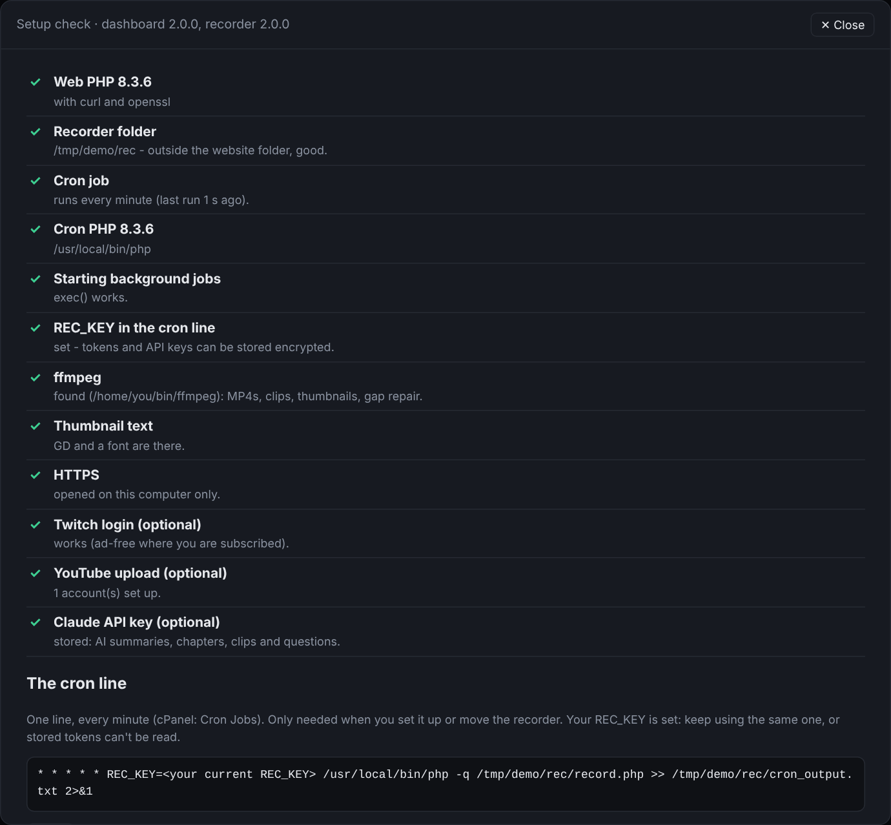
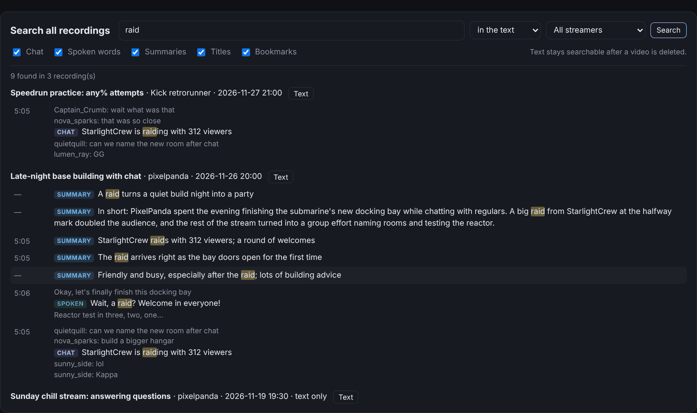
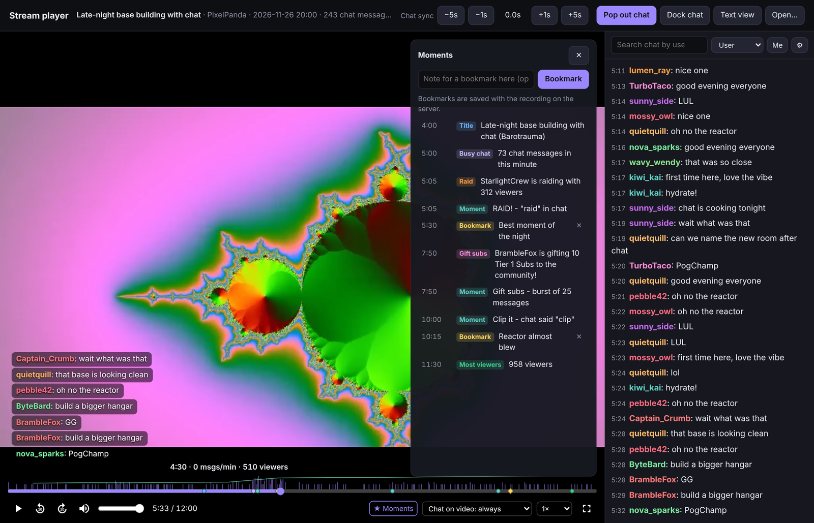
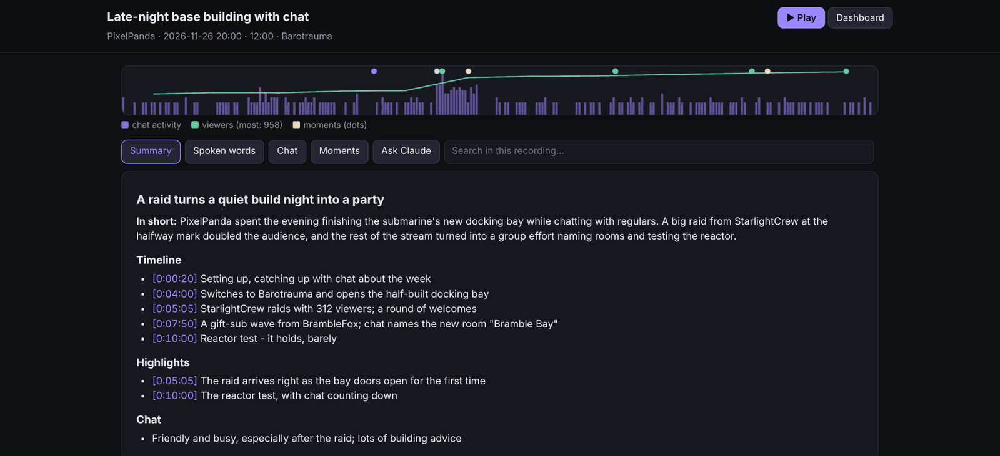
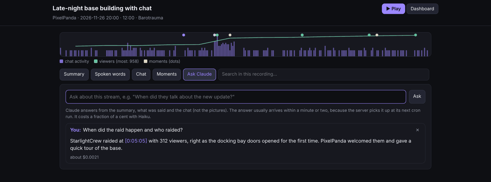
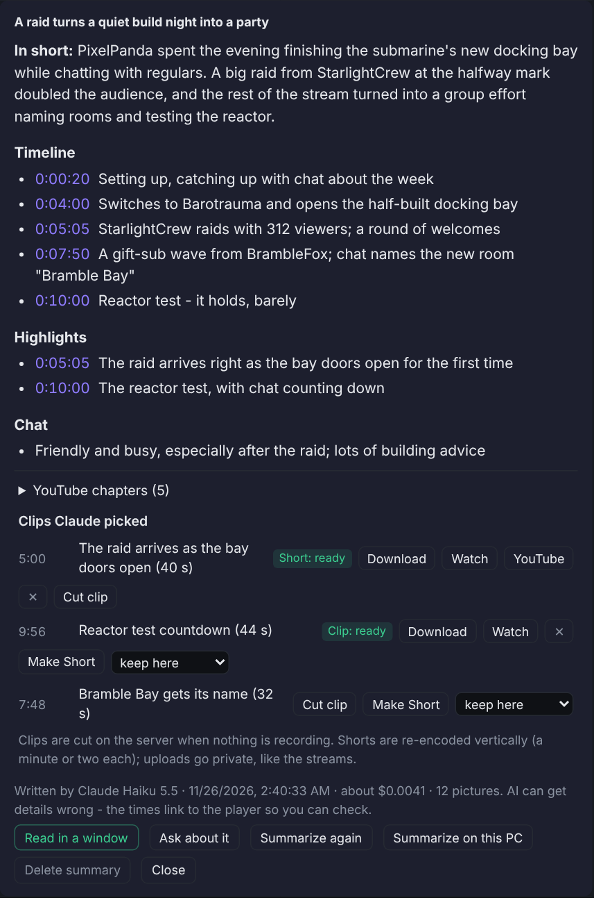

# Using the dashboard

## Logging in

Open the dashboard's address and paste the key from `secret/dashboard_key.txt` (in the recorder folder; the local start script also prints it). The browser stays logged in for 180 days, and a password manager can save the key.

- **New key / log out every browser:** delete both `dashboard_key.txt` and `dashboard_key.hash`. The next recorder run creates a new key.
- After logging in on all your devices you may delete `dashboard_key.txt`; the dashboard only needs the `.hash`.

## Header

The header stays at the top while you scroll. At the bottom of the page, the ↑ button next to the footer brings you back up.

- **Log out** ends the login in this browser. **Log out everywhere** ends every login, on all devices.
- **Setup check** shows, in one list, what the cron job's PHP has (version, `exec()`, ffmpeg, GD and a font), whether `REC_KEY` is set, whether the cron job runs, and which optional parts (Twitch login, YouTube, Claude) are set up. Anything that needs doing says how, and the exact cron line for your folders is at the bottom.
- **Notices** under the header:
  - **Key copy:** a reminder to delete the plain-text key copy once you've saved the key (button included).
  - **Folder warning:** a red warning when the recorder folder is inside the website's folder.
  - **New version:** once a day the dashboard asks GitHub whether a newer release is out (`UPDATE_CHECK`), and links to it. Nothing about you or your setup is sent.
  - **Versions differ:** the dashboard and recorder folders are at different versions (one was updated, the other not).

- **Twitch token**: working, not working, or not set (hover for details). Only relevant if you use the [token](twitch-token.md).
- **Cron**: when the recorder last ran. It turns red when there has been no run for 3 minutes (the cron job or start script stopped).

## Tiles

One row that adapts to what's going on:
- **Recording now**: how many streamers are live.
- **Alerts**: new alerts, shown when there are any.
- **YouTube**: accounts and queue.
- **Converting / Uploading**: shown while those run.
- **Server processes**: running conversions and recorder runs. Red if two conversions ever run at once.
- **Storage**: space used, and free space.

## Disk IO

- **What it shows:** how much the account's processes read and write per second, split into recording, converting and other (your website, other tools), over 1 h, 6 h or 24 h.
- **The dashed line** is your host's limit (`IO_LIMIT_MB` in the dashboard config).
- **Details:** hover for exact numbers, or switch to *Table*.
- **Accuracy:** measured every 5 seconds from Linux's per-process disk counters. Very short processes (single web requests) can be missed, so your host's own statistics may show a little more.

## Alerts

Everything worth knowing, newest first, with the full text under *Details*:
- a stream ended, with its summary;
- Twitch token problems;
- conversion or upload problems, and successful uploads with a link;
- low disk space;
- a streamer name that doesn't exist.

There is no email: the dashboard is the place to look. "Mark all as read" is remembered per browser.

## Search

**Search all recordings** finds a word or a name in everything that was written down: chat, what was said (after a PC scan), summaries, titles and bookmarks. Pick *in the text* or *from a user*, one streamer or all, and untick what you don't want. Each hit shows a few lines around it; its time opens the player there, and **Text** opens the recording's text view. Text stays searchable after a video is deleted.

## Streamers

- **Add:** type a Twitch name, or paste a link to a channel on Twitch, Kick or YouTube (`kick.com/name`, `youtube.com/@name`). With *record right away* ticked, recording is switched on immediately. Kick and YouTube work a little differently; see [platforms.md](platforms.md). **Test Kick / YouTube access** checks whether your server can reach them.
- **Switch on/off:** the switch in front of each name.
  - **Switching off a live streamer** asks first; the recording so far is kept and handled like any finished recording (chat sync, MP4, upload, alert).
  - **Switching on during a stream** starts recording within a minute.
- **Upload to YouTube:** choose an account, or no upload ([youtube.md](youtube.md)).
- **Your Twitch login:**
  - *Auto*: use your token only on channels where your account is ad-free.
  - *Always*: always use it.
  - *Never*: record anonymously.
- **PC scan after each stream:** *Ask me* shows a Scan/Skip question after each stream, and a YouTube upload waits for your choice ([pc-scan.md](pc-scan.md)). *Off*: no question; you can still scan any recording with its **Scan** button.
- **Video storage:** *Keep video forever*, delete video after 7/30/90/365 days, or keep only the newest 5/10/25. Only the video goes; chat, the spoken words and the summary stay, so the recording stays searchable and readable as text. Recordings marked **Keep video** are never touched, nor anything still recording, converting or uploading.
- **AI check-in:** with live check-ins on (AI card), the card of a live streamer shows what's going on, refreshed every 30 minutes.
- **Remove streamer:** available when switched off. Recordings stay until you delete them.
- **Order:** switched-on streamers first (live ones on top), switched-off ones below. Click a name bar to fold a card to one line.

Badges: **Recording**, **Waiting for stream** (on, streamer offline), **Not found** (check the spelling), **Off**, **Stopping…** (switched off, last recording being wrapped up).

## Recordings

Each recording shows its title, date, length, files, size and status. Running conversions and uploads show a progress bar with the time left.

- **▶ Play** opens the player in a new tab:
  - **Download to this PC, then play** (Chrome/Edge). The speed is capped below your host's disk IO limit (`DOWNLOAD_LIMIT_MB`, default 80% of `IO_LIMIT_MB`), so it runs steadily instead of hitting the limit in bursts:
    - The first time, pick a folder (e.g. Videos); it's remembered.
    - Each recording gets a subfolder with `video.mp4`, `chat.txt` and `meta.json`. It downloads with automatic retries, can be paused and continues where it stopped, then plays from your PC.
    - The video is saved in 256 MB pieces (a `video-parts` folder) that are joined into `video.mp4` at the end. So the speed stays the same however big the recording is. Joining needs free space for a second copy for a moment.
    - While it downloads, a YouTube upload on the server waits (both read big files and share your host's IO limit); it continues by itself afterwards.
  - **Stream from the server**: plays right away, but can stutter on long or high-quality streams.
  - Other browsers get plain download links.
- **Text** opens the [text view](#the-text-view): summary, spoken words, chat and moments as readable, searchable text.
- **Gap repair:** when a Twitch recording had holes (an ad break, a missed piece, a late start), the line says how many were filled from the VOD before the MP4 was made ([details](how-it-works.md#gap-repair)).
- **Logs:** the *Recent log* box shows the last lines. *Full log* opens the whole log in a new tab, without the routine "offline" lines; *everything* includes them, and *download* saves it as a file. A log rotates at `LOG_MAX_MB`; *older part* opens the previous one.
- **YouTube** uploads a finished recording by hand, for example when the streamer's upload setting was off. Pick the account and press *Upload*:
  - It goes in the same queue as the automatic upload, with the same title, description and moments. It starts at the next cron run while nothing records.
  - A recording still waiting for its MP4 conversion is uploaded right after the conversion.
  - *Cancel upload* takes it out of the queue again. *Upload again* appears for a recording that's already on YouTube.
  - For a stream that's still being recorded, set the account in the streamer's settings instead: it's uploaded when the stream ends.
- **Scan** opens the [PC scan](pc-scan.md) for subtitles, translation and spoken-word moments. While a scan runs, the recording shows its progress, with *Open scan* to continue and *cancel*. Afterwards the line lists the subtitles and chat translations it has; *Scan again* adds, for example, another translation.
- **Summary** opens the [AI summary](ai-summary.md) of the stream under its line; its times open the player at that point. *Summarize* (when there's none yet) lets Claude write one, or opens the scan page to write it with Chrome's built-in AI when no API key is set. While one is being made, the line shows its progress and *cancel*.
- **Keep video** protects this recording's video from the streamer's storage rule. **Video only** deletes just the video and keeps the text (the recording then shows *text only*).
- **Delete** asks for confirmation, then removes the whole recording folder. It's not possible while that stream is still recording, converting, uploading or cutting a clip.

### The player

- **Activity strip:** above the seek bar, how busy chat was and how many people watched, with dots for moments. Hover for numbers; click to jump.
- **Moments** (★ or B): one list of everything worth jumping to: title and category changes, raids and gift subs, chat bursts, the most viewers, what your YouTube moments rules found, and your own **bookmarks**. Type a note and press *Bookmark* (or press B) to mark the current time; bookmarks are saved with the recording on the server, so they show up on every device and in search.
- **Chat on the video:** *off*, *full screen only* or *always*. Drag the chat box anywhere on the picture and resize it from its corner; the place is remembered.
- **Emotes:** ⚙ in the chat bar can show emote pictures (Twitch, Kick, YouTube, 7TV, BTTV, FFZ) instead of their names. Off by default, because the pictures load from those services.
- **Seek bar:** hover it for a preview picture and the time; click or drag to jump. Previews are made in your browser from the video file, for recordings on your PC or downloaded through *Play*. When streaming from the server you see only the time, so no extra video is pulled from your host.
- **Chat search:** type in the bar above the chat to see every message from a user (switch to *Message* to search the text instead). Usernames autocomplete.
  - Click a result to jump to that moment.
  - Hits are also shown as yellow ticks on the seek bar.
  - **Me** shows your own messages. Clear the box (or press Escape) to get the live chat back.

- **Your name:** your own messages get a purple marker, and messages that mention you get a yellow one.
  - Opened from the dashboard, the player knows your name from the Twitch token.
  - Otherwise set it with ⚙ in the chat bar (remembered per browser).
- **Subtitles and translated chat** after a [PC scan](pc-scan.md): a subtitles menu next to the speed control, and a *Translated* button in the chat bar (hover a message for the original).
- **Subtitle style:** drag the subtitles anywhere on the picture, and drag their corner to make them bigger or smaller. **Aa** next to the subtitles menu sets the size, font, text colour, outline (thin, thick or shadow) and background (none, per line or a box, with colour and opacity). It's remembered in this browser, also in full screen; *Reset* puts it back.
- **Chat sync ±** nudges chat if it feels early or late. Click a chat timestamp to jump there.
- **Pop out chat** opens chat in its own window for a second screen, with the same search.
- **Keys:** Space or K (play/pause), ←/→ (5 s), M (mute), F (fullscreen, also double-click), C (chat window).

### The text view

Everything that was written down about a recording, on one page that loads instantly, also for long streams: **Summary**, **Spoken words** (after a PC scan), **Chat**, **Moments** and **Ask Claude**. The activity graph at the top and every time link open the player at that moment. Search within the recording filters the tab you're on.

**Ask Claude** answers a question about the stream from its summary, spoken words and chat, with times you can click (a fraction of a cent with Haiku; needs the Claude key).

## AI summaries

The **AI summaries** card holds the API key for Claude, the model, and whether every stream is summarised automatically and with pictures. It shows whether the key works and what the summaries have cost so far. Under *Also*:
- **YouTube chapters** and **Thumbnail on YouTube**: from the summary, Claude picks chapters for the description and the best picture plus a few words for the thumbnail.
- **Live check-ins** on the streamer's card while they're live.
- **Weekly digest**: every Monday, last week's streams in one overview.

Under a summary, **Clips Claude picked** lists the best moments: *Cut clip* makes an MP4 of it on the server, *Make Short* a vertical version for YouTube Shorts, and either can be uploaded to a YouTube account. Step-by-step setup, costs and the free alternative are in [docs/ai-summary.md](ai-summary.md).

## YouTube moments

Rules that look for specific moments in a recording and tag its YouTube upload:

| Rule | Finds |
|---|---|
| Chat message contains | A message (including raid/sub announcements) with that word or phrase |
| Message from user | Every message from that user |
| Chat burst | At least N messages (optionally containing a word, e.g. `LUL`) within S seconds: hype moments |
| Category or title contains | The stream's category or title, at the start or after a change |
| Streamer says (PC scan) | A word or phrase the streamer said, in the original or the translation. Needs a [PC scan](pc-scan.md) of the recording |

- **Scope:** each rule is for all streamers or one.
- **Labels:** each rule has a label; tick *in title* to also add it to the title.
- **When found:**
  - the title becomes `Streamer - Title (date) | Label | …`; the stream title is shortened if needed to stay within YouTube's 100 characters;
  - the description gets a *Moments* list with a timestamp per moment (clickable on YouTube).
- **When the scan runs:** right after the stream ends and again just before the upload, so rules you add later still apply to recordings waiting for upload. The PC uploader uses the last scan result.
- **Test first:** *Test on this recording* runs the current rules on any recording and shows the title and description it would get.

The scan works on chat, stream info and, after a [PC scan](pc-scan.md), what the streamer said. It doesn't look at the picture.
