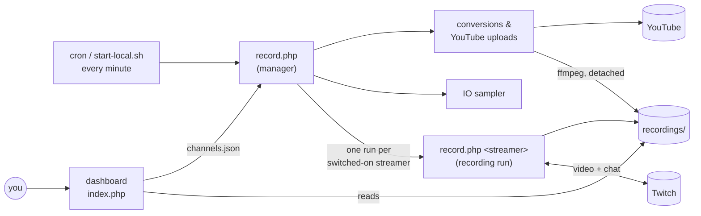

# How it works



## The pieces

- **`server/record.php`**: everything server-side, in one file.
  - **Manager** (started every minute without arguments): reads the streamer list, starts a recording run for each switched-on streamer, and does the background work (token check, conversions, uploads, IO sampling). Each piece runs as its own short process.
  - **Recording run** (`record.php <streamer>`): checks whether the streamer is live and records video and chat.
- **`dashboard/index.php`**: the web interface, plus a small JSON API used by the page itself. It never talks to Twitch; it reads the recorder's files and writes only `channels.json` and deletions.
- **`dashboard/player.html`** and **`pc-tools/player.html`**: the same player file, served by the dashboard or opened from disk.

## Recording in relays

Many hosts stop processes that run for a long time, and cron only starts things once a minute. So instead of one process per stream, runs take turns:

1. A run records for at least `MIN_RUNTIME` (50 s).
2. The next minute's run prepares everything while the first is still recording: live check, playlist, chat connection. Then it signals that it's ready.
3. The first run finishes its current segment and exits; the waiting run takes over within ~2 seconds.

Video segments and chat messages seen by both are de-duplicated, so the recording is continuous. Tested over 160+ handovers without a gap. Locks (`flock`) guarantee one recording run and at most one waiting successor per streamer. If a run is killed, the next one notices and logs it.

The playback session is reused between runs (~20 min), so to Twitch it looks like one viewer, and pre-roll ads aren't triggered on every run.

## Video

- **Source:** Twitch's HLS playlist (`.ts` segments) via the same requests its web player makes.
- **Ads:** ad segments (titled differently from `live`) are dropped.
- **Parts:** video is written to `parts/001.ts`, `002.ts`, … A new part starts wherever timestamps can jump: a new session, an ad break, a gap.
- **Chat sync:** the wall-clock time of every part start is kept (`meta.json` → `timeline`), so chat stays in sync after jumps.

## Chat

- **Connection:** anonymous connection to Twitch chat over WebSocket on port 443. Port 6667 is often blocked on shared hosting.
- **What's logged:** messages, subscriptions, raids, timeouts and bans, as `[time] user: message` in `chat.txt`, de-duplicated by message id.
- **Sync info:** at the end of the stream the sync info is written into the first line of `chat.txt` (`#META {...}`), so `video.mp4` + `chat.txt` alone are enough to play it back anywhere.

## Conversion

- **Method:** ffmpeg's concat demuxer joins the parts end to end with `-c copy`: lossless, no re-encoding.
- **Fragmented MP4:** keeps memory flat (~50 MB) however long the stream; a normal MP4 builds its index in memory until the end.
- **Detached:** ffmpeg runs separately from the PHP run that started it, because hosts that stop long PHP processes would otherwise take the conversion down too. Each later run only checks on it, and when it's done checks the result.
- **Checks before deleting anything:** the MP4's duration must match the recording (≥ 90 %); only then are the `.ts` parts deleted. A shorter MP4 keeps both and raises an alert.
- **Polite to the host:** runs at the lowest CPU/IO priority, only while nothing records (`CONVERT_WHEN_IDLE`), optionally speed-capped (`CONVERT_SPEED`), and only after a disk-space check.

## Files

```
server/
  record.php, config.php
  channels.json              streamer list (the dashboard edits it)
  recordings/
    .notifications.json      alerts
    .io_history.json         IO graph data (24 h, per minute)
    .convert_queue.json, .upload_queue.json, .system.log, .settings.json
    <streamer>/
      recorder.log, state.json
      2026-11-17_150000_<streamid>/
        video.mp4            after conversion (parts/NNN.ts while recording)
        chat.txt             chat, first line = sync info
        meta.json            title, times, timeline, YouTube link
        summary.txt          end-of-stream summary
  secret/                    dashboard key, encrypted tokens (never web-reachable)
  last_run.txt, cron_output.txt
```

`recordings/` and `secret/` get a `.htaccess` that denies web access, as a second line of defence in case the recorder folder ends up inside a web root.
